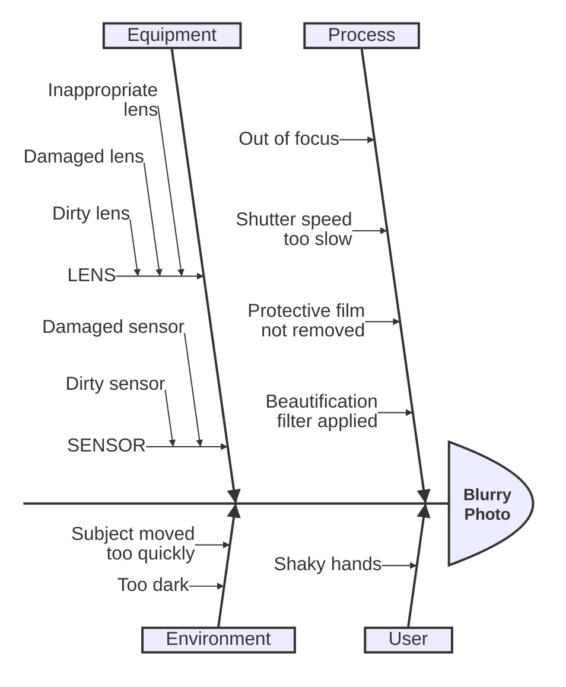
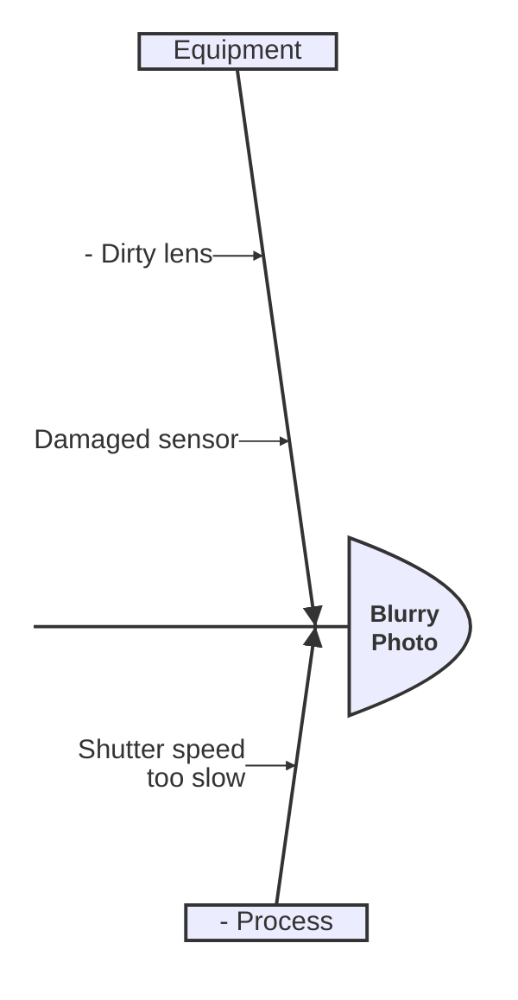

> **Warning**
>
> ## THIS IS AN AUTOGENERATED FILE. DO NOT EDIT.
>
> ## Please edit the corresponding file in [/packages/mermaid/src/docs/syntax/ishikawa.md](../../packages/mermaid/src/docs/syntax/ishikawa.md).

# Ishikawa diagram (v11.12.3+)

Ishikawa diagrams are used to represent causes of a specific event (or a problem).
They are also known as fishbone diagrams, herringbone diagrams or cause-and-effect diagrams.
The diagram resembles a fish skeleton, with the main problem at the head and the causes branching off from the spine.

## Syntax

- The first line is the event (problem) of the diagram.
- Subsequent lines are causes of the event.
- "Fishbone" structure is indicated by indentation.

## Eliminated items

Prefix an item with an ASCII hyphen followed by a space or tab (`- Item`) to mark it as
eliminated. Its label is displayed with visible strike-through and one adjacent `×` symbol.
The item and its connecting branch remain in the diagram, so ruled-out causes can stay visible
alongside candidates that still need investigation. No special font or HTML is required.

In this example, `Dirty lens` and `Process` are crossed out and each has a `×` beside it.
`Shutter speed too slow` remains active: elimination applies only to the explicitly prefixed item,
not to its children, parents, or siblings.

- Both `ishikawa` and `ishikawa-beta` support this syntax.
- Effects (the first item), causes, and nested subcauses can all be marked eliminated.
- One or more spaces or tabs must separate the hyphen from a nonempty label. The prefix is not
  displayed, and it does not change the indentation or hierarchy.
- Every line of a wrapped or multiline eliminated label is crossed out. The adjacent symbol is not.
- `-Item`, `-5`, `--Item`, a lone `-`, internal hyphens, and non-ASCII dashes remain ordinary text.
- Remove the `- ` prefix to restore an item's ordinary presentation.

> **Warning**
> Labels previously beginning with `- ` now indicate elimination instead of displaying that prefix
> literally. There is no escape syntax for a literal label starting with this reserved sequence.
